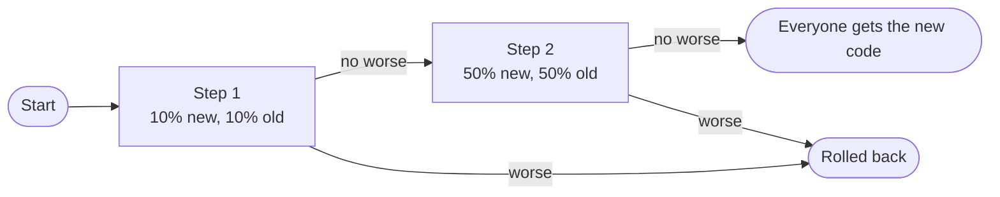

# open-rollout

[](https://github.com/dholliday3/open-rollout/actions/workflows/ci.yml)
[](LICENSE)

**Guarded feature flag rollouts for TypeScript.** open-rollout turns a flag on for more people step by
step, checks your metrics at every step, and rolls back on its own when the new code is worse.

Use your own flag provider, analytics and job runner. PostHog adapters are included.

> **Status:** pre-1.0, not on npm yet. Tested in simulation; no production rollout has used it.
> [Details](#project-status)

## Why open-rollout

- **Catch a bad release at 10%, not 100%.** In simulation, a total outage was caught in every rollout,
  in a median 8.6 minutes, after 15 people had seen it.
- **Check every minute without false alarms.** It uses a statistical test built for repeated looks.
  Healthy code was wrongly flagged in 0.3% to 3% of rollouts, inside a 5% budget.
- **Safe to automate.** Retries, crashes, two workers at once, a person editing the flag mid-rollout:
  16,000 chaotic simulation runs broke none of its guarantees.
- **No vendor lock-in.** Flags, metrics, storage and scheduling stay yours. Moving to another flag
  provider means writing one adapter.
- **Ready for AI agents.** Seven tools with zod schemas let an agent start, check, pause, approve or
  roll back a rollout.

### Without it, and with it

| Today | With open-rollout |
|---|---|
| A person moves a slider and watches a dashboard | Steps advance on a schedule, only when the data says so |
| Checking a t-test every minute rolls back healthy code by chance | The test stays valid however often it looks |
| A script that crashes mid-rollout leaves the flag wherever it stopped | Every decision is saved before the flag is written; the next run carries on |
| Automatic rollback means buying one vendor's flags and metrics | It runs on the flags and metrics you already have |

## Quickstart

```sh
pnpm add github:dholliday3/open-rollout
```

This rolls out a new checkout against simulated traffic, an hour of it in under a second:

```ts
import {
  createAutopilot,
  createMemoryFlags,
  createMemoryNotifier,
  createMemoryStore,
  standardPlan,
} from "open-rollout";
import { simulatedTraffic } from "./simulated-traffic.js";

const flags = createMemoryFlags();
const notifier = createMemoryNotifier();
const traffic = simulatedTraffic({
  flags,
  flagKey: "new-checkout",
  metric: "errors",
  errorRate: { control: 0.02, treatment: 0.02 },
});
const autopilot = createAutopilot({
  flags,
  metrics: traffic,
  notifier,
  store: createMemoryStore(),
});

const plan = standardPlan({
  flagKey: "new-checkout",
  risk: "low",
  guardrails: [
    {
      metric: "errors",
      kind: "rate",
      direction: "lower_is_better",
      tolerance: 0,
      onRegression: "rollback",
    },
  ],
});
await autopilot.start({ id: "checkout-1", plan, now: traffic.now() });

for (let minute = 0; minute < 60; minute += 1) {
  traffic.passMinute();
  await autopilot.tickAll(traffic.now());
}

for (const event of notifier.events) {
  console.log(`${event.type}: ${event.detail}`);
}
```

```text
started: Rollout of new-checkout started.
step_started: 10% of traffic is on the new behaviour.
step_started: 50% of traffic is on the new behaviour.
releasing: Every step passed. Releasing to everybody.
released: Released: the flag is on for everybody.
```

Make the new code error five times as often (`treatment: 0.1`) and it is rolled back three minutes in,
at 10%. Run it yourself with `pnpm quickstart` ([`examples/quickstart.ts`](examples/quickstart.ts)).

## How it works



1. **Pick a plan.** A plan is the list of steps and the metrics to guard.
2. **Run a tick every minute or so** from any scheduler. Each tick reads the flag and the metrics, decides
   the next move, saves it, then changes the flag.
3. **Each step splits traffic evenly** between the new and old code (10% and 10%, then 50% and 50%), so a
   bad hour hits both sides alike.
4. **Each guardrail compares new against old.** Worse means roll back. Too little data means wait, never
   move forward.
5. **Every step passed** means release to everybody.

### Plans

`standardPlan({ flagKey, guardrails, risk })` picks the steps for you:

| Risk | Steps (share on the new code) | Shortest watch per step | Needs a person |
|---|---|---|---|
| `low` | 10%, 50% | 10 min each | no |
| `medium` | 1%, 10%, 25%, 50% | 10 to 20 min | no |
| `high` | 1%, 5%, 10%, 25%, 50% | 30 min to 4 h | yes, before release |

A guardrail is `{ metric, kind, direction, tolerance, onRegression }`, where `kind` is `rate`, `mean` or
`ratio`. Plans are plain objects, so you can write your own and check them with `planProblems(plan)`.

Two options adjust a standard plan: `sourceLagMs` for metrics that run behind, such as a warehouse
loaded hourly, and `overrides` for its steps, limits and policies, such as fewer units and longer steps
for a product with few accounts.

## Real-world examples

Six problems, solved with the current API. Each snippet is a slice of
[`examples/recipes.ts`](examples/recipes.ts), and [`examples/recipes.test.ts`](examples/recipes.test.ts)
runs them against the quickstart's simulated traffic or a fake.

<details>
<summary><b>Rolling out a new billing engine to B2B accounts, not people</b></summary>

<br>

**By hand:** a dashboard counts people, but one company's users fail together, so the numbers look surer
than they are. With few accounts, a 1% step may hold nobody to compare.

```ts
function billingEngine(postHog: PostHogConnection): { metrics: MetricSource; plan: RolloutPlan } {
  const metrics = createPostHogMetrics({
    ...postHog,
    unit: { groupTypeIndex: 0 },
    metrics: { invoice_failed: { event: "invoice failed", mayBeUnseen: true } },
  });
  const plan = standardPlan({
    flagKey: "billing-engine-v2",
    risk: "low",
    guardrails: [
      { metric: "invoice_failed", kind: "rate", direction: "lower_is_better", tolerance: 0,
        mustRuleOut: 0.05, onRegression: "rollback" },
    ],
    overrides: {
      everyStep: { minDurationMs: DAY, minFreshUnits: 20 },
      requiresApprovalToRelease: true,
    },
  });
  return { metrics, plan };
}
```

**What happens:** PostHog counts each account (`$group_0`) once. The low-risk ladder starts at 10%; each
step waits at least a day and for 20 new accounts a side, and passes only once invoice failures 5
percentage points worse are ruled out. A person approves the release. `postHog` holds the project id,
transport and lag, built as in [`examples/posthog.ts`](examples/posthog.ts).

</details>

<details>
<summary><b>A checkout redesign that might hurt conversion</b></summary>

<br>

**By hand:** errors stay flat while fewer people buy, so the error graph stays green. Conversion needs a
guardrail of its own, where higher is better.

```ts
const checkoutPlan = standardPlan({
  flagKey: "checkout-redesign",
  risk: "medium",
  guardrails: [
    { metric: "converted", kind: "rate", direction: "higher_is_better", tolerance: 0,
      onRegression: "rollback" },
    { metric: "errors", kind: "rate", direction: "lower_is_better", tolerance: 0,
      onRegression: "rollback" },
  ],
});
```

**What happens:** On simulated traffic where 10% convert on the old checkout and 6% on the new, it rolls
back during the 10% step, 23 minutes in; an equally good checkout is released in 69 minutes. In the full
simulation a 40% drop was caught in 100 of 100 rollouts ([evaluation](docs/evaluation.md)).

</details>

<details>
<summary><b>Moving traffic to a rewritten backend service</b></summary>

<br>

**By hand:** a latency graph is an average over requests that a few busy callers set, and one caller's
requests succeed or fail together, so counting each request as a sample makes a blip look certain.

```ts
const serviceMetrics: Record<string, MetricDefinition> = {
  ms_per_request: { event: "api request", property: "duration_ms", denominatorEvent: "api request" },
  errors_per_request: { event: "api error", denominatorEvent: "api request", mayBeUnseen: true },
  had_error: { event: "api error", mayBeUnseen: true },
};

const serviceGuardrails: Guardrail[] = [
  { metric: "ms_per_request", kind: "ratio", direction: "lower_is_better", tolerance: 20,
    onRegression: "rollback" },
  { metric: "errors_per_request", kind: "ratio", direction: "lower_is_better", tolerance: 0,
    onRegression: "rollback" },
  { metric: "had_error", kind: "rate", direction: "lower_is_better", tolerance: 0,
    onRegression: "rollback" },
];
```

**What happens:** Each `ratio` measures per request but counts callers, and `tolerance: 20` allows 20 ms
a request slower. Latency is a `ratio`, not a `mean`: a mean of latency summed per person follows the
busiest people ([statistics](docs/statistics.md)). An outage took a median 28 minutes to catch on a ratio
in simulation and 8.6 on a rate ([evaluation](docs/evaluation.md)), so `had_error` is there too.

</details>

<details>
<summary><b>Your metrics come from a warehouse that lags an hour</b></summary>

<br>

**By hand:** you wait an hour for each number before you move the slider. A tool that expects fresh data
reads hour-old numbers as an outage, and a step timed in minutes ends before its data arrives.

```ts
const searchErrors: Guardrail = {
  metric: "errors",
  kind: "rate",
  direction: "lower_is_better",
  tolerance: 0,
  onRegression: "rollback",
};

const searchPlan = standardPlan({
  flagKey: "search-ranking-v2",
  risk: "low",
  guardrails: [searchErrors],
  sourceLagMs: HOUR,
});
```

**What happens:** With metrics an hour behind, healthy code is released in 145 minutes. Without
`sourceLagMs` the flag is never turned on: the metrics read as stale, and `metrics_outage` is reported 16
minutes in. A plan that declares a lag it has no room for is refused:

```ts
const unprepared = standardPlan({
  flagKey: "search-ranking-v2",
  risk: "low",
  guardrails: [searchErrors],
});
const lagProblems = planProblems({
  ...unprepared,
  limits: { ...unprepared.limits, sourceLagMs: HOUR },
});
```

```text
Metrics that run 60 minutes behind are always older than maxStalenessMs, so the rollout would never read them. Make it more than the lag.
Step 1 gives up before metrics that run 60 minutes behind can cover its watch. Give it a maxDurationMs more than the lag past its minDurationMs.
Step 2 gives up before metrics that run 60 minutes behind can cover its watch. Give it a maxDurationMs more than the lag past its minDurationMs.
```

</details>

<details>
<summary><b>Let on-call (or an AI agent) pause and roll back from Slack, but only release leads can release</b></summary>

<br>

**By hand:** whoever can reach the flag can push it to everybody and skip every check. On-call needs
pause and rollback without that power.

```ts
const releaseLeads = new Set(["U02LEAD", "U07LEAD"]);
const anyone = new Set(["rollout_status", "rollout_pause", "rollout_rollback"]);

function slackTools(autopilot: Autopilot): RolloutTools {
  return rolloutTools(autopilot, {
    authorize: ({ tool, actor }) =>
      anyone.has(tool) || releaseLeads.has(actor)
        ? { allowed: true }
        : { allowed: false, reason: "Only a release lead can do that." },
  });
}
```

**What happens:** A release from anyone else answers `Not allowed: Only a release lead can do that.` and
changes nothing; their rollback goes through. The Slack user id is the `actor`, and the message id makes
a good `callKey`.

</details>

<details>
<summary><b>You keep flags in your own Postgres table, not a vendor</b></summary>

<br>

**By hand:** someone edits a row and watches a graph, and two edits at once quietly overwrite each other.

```ts
interface FlagRow { readonly control: number; readonly treatment: number; readonly revision: number }
type QueryRow = (sql: string, values: readonly unknown[]) => Promise<FlagRow>;

function tableFlags(queryRow: QueryRow): FlagControl {
  return {
    refusesStaleWrites: true,
    read: async (flagKey) => {
      const row = await queryRow("SELECT * FROM flags WHERE key = $1", [flagKey]);
      return { allocation: { control: row.control, treatment: row.treatment }, revision: row.revision };
    },
    write: async (flagKey, allocation, expectedRevision) => {
      const row = await queryRow(
        `UPDATE flags SET control = $2, treatment = $3, revision = revision + 1
         WHERE key = $1 AND ($4::bigint IS NULL OR revision = $4) RETURNING *`,
        [flagKey, allocation.control, allocation.treatment, expectedRevision ?? null],
      );
      return row.revision;
    },
  };
}
```

**What happens:** An update lands only on the revision it read, so a stale write fails and the next tick
puts it right. `queryRow` runs one statement and returns its row or throws. Your app still has to bucket
each user once, so a bigger share keeps everyone who was in.

</details>

## Using it in production

### Run ticks from your scheduler

All state lives in the store, so cron, a BullMQ job or a durable workflow all work. Two schedulers ticking
the same rollout is safe.

```ts
async function tickRollouts(autopilot: Autopilot): Promise<void> {
  const results = await autopilot.tickAll(Date.now());
  const problems = results
    .filter((result) => result.status === "failed")
    .flatMap((result) => result.problems);
  if (problems.length > 0) {
    throw new Error(problems.join(" "));
  }
}
```

People and services steer a rollout with `autopilot.command(id, command, now)` (`pause`, `resume`,
`rollback`, `release`, `approve`) and read it with `autopilot.inspect(id)`.

### Connect PostHog

1. Make a multivariate flag with variants `control` and `treatment` at 50/50, and one release condition
   at 0%.
2. In your app, check `flag === "treatment"`.
3. Wire the adapters from `open-rollout/posthog` with your API key, as in
   [`examples/posthog.ts`](examples/posthog.ts).
4. To count accounts instead of people, give the metric source `unit: { groupTypeIndex }`, the index of
   your PostHog group type (`$group_0` to `$group_4`).

Every write carries the flag's version, so PostHog itself rejects a late write from a stalled worker.

### Give an AI agent the controls

`rolloutTools(autopilot)`, from `open-rollout/tools`, returns `rollout_start`, `rollout_status`,
`rollout_pause`, `rollout_resume`, `rollout_rollback`, `rollout_approve` and `rollout_release`, each with a
zod input schema. They wrap into an AI SDK tool or an MCP server in a few lines.

```ts
async function rollBackCheckout(autopilot: Autopilot): Promise<ToolAnswer> {
  const tools = rolloutTools(autopilot);
  const answer = await tools.rollout_rollback.run(
    { id: "checkout-1", note: "Support is seeing failed payments." },
    { actor: "alice", callKey: "session-42:call-7", now: Date.now() },
  );
  return answer;
}
```

A retried call with the same `callKey` is applied once. Without a check of your own, any actor can call
any tool, including `rollout_release`, which skips the checks that are left. Pass
`rolloutTools(autopilot, { authorize })` to allow or refuse each call by tool, input and actor.

### Promote across environments

`createReleaser({ store, autopilotFor })` takes one change through environments in order, such as staging
then production. A rollback in one environment holds the ones that haven't started.

## Adapters

open-rollout talks to the outside world through four small interfaces:

| Interface | Its job | Included |
|---|---|---|
| `FlagControl` | Read and write the flag, with a revision number that only goes up | Memory, PostHog |
| `MetricSource` | Totals for the new and old code since a time | Memory, PostHog (HogQL) |
| `RolloutStore` | Save each rollout with compare-and-set | Memory, plus a [one-table Postgres design](docs/guarantees.md#a-postgres-store) |
| `Notifier` | Send rollout events wherever you want them | Memory |

Another flag provider needs only a `FlagControl`: a revision number that goes up on every change, and
sticky percentage bucketing.

## What it promises

1. Never more exposure than the rollout says.
2. Never forward without evidence.
3. A rollback always wins.
4. A person who lowers the flag is left alone.
5. One flag write per decision; a command sent twice is applied once.
6. The false-alarm rate holds however often it looks.
7. After any mix of failures, a few clean ticks put the flag where it should be.

Each promise, and what it rests on: [docs/guarantees.md](docs/guarantees.md).

## Results in simulation

Medium-risk plan, 100 rollouts per row ([all results](docs/evaluation.md)):

| The new code… | Caught | Median time | People exposed first |
|---|---|---|---|
| Fails completely | 100% | 8.6 min | 15 |
| Errors twice as often | 100% | 49 min | 750 |
| Converts 40% worse | 100% | 50 min | 838 |
| Errors 1.25 times as often | 35% | 67 min | 2,235 |

Healthy code was flagged as worse in 0.3% to 3% of rollouts across ten settings, inside a 5% budget.

## Good to know

- **Small regressions can pass.** Set `mustRuleOut` on a guardrail to require proof that the new code
  isn't worse by more than an amount you choose.
- **Ratio guardrails are slower.** An outage took a median 28 minutes to catch on one, against 8.6 on a
  rate.
- **Rolled back means the provider serves the flag off.** Apps holding a cached flag catch up on their
  next fetch.
- **Providers that can't reject a stale write** have one rare gap: a worker frozen mid-write for over 10
  minutes can land an old step. PostHog rejects such writes.

More in [docs/limits.md](docs/limits.md).

## Compared to LaunchDarkly

LaunchDarkly offers guarded rollouts inside its own platform. open-rollout follows the rules it publishes
where they are known: equal traffic on both sides, a largest measured step of 50%, a sequential test on
new minus old, and a sample ratio check.

| | open-rollout | LaunchDarkly guarded rollouts |
|---|---|---|
| Where it runs | In your code, on your scheduler | In LaunchDarkly |
| Flags and metrics | Any provider, through adapters | LaunchDarkly's |
| A step that never gets enough data | Pauses and asks a person (standard plans) | Rolls back |
| Flags proposed from pull requests | Not built | Yes |

## Project status

- **Built and tested:** the decision core, the tick loop, the statistics, in-memory adapters, agent tools
  and multi-environment releases.
- **Not yet proven against the real service:** the PostHog flag adapter has never written a real flag.
  Its tests use a fake that enforces versions the way PostHog's docs describe.
- **Not built:** a database-backed store, adapters for other providers, and percentile metrics.
- **May change:** any API, before 1.0.

<details>
<summary>Requirements: Node 22.12+</summary>

<br>

The package is compiled JavaScript with type declarations, built when it is installed from GitHub:

- It is ES modules only. Plain `node` runs it; CommonJS code can `require()` it, which Node 22.12 and
  later allow for ES modules.
- Three entry points: `open-rollout` (the core, which loads no other package), `open-rollout/posthog`
  and `open-rollout/tools`. The one runtime dependency is zod 4, loaded only by the last two.
- TypeScript needs `"moduleResolution"` set to `node16`, `nodenext` or `bundler`. The types compile with
  `strict`, `exactOptionalPropertyTypes`, `noPropertyAccessFromIndexSignature` and
  `noUncheckedIndexedAccess` on and `skipLibCheck` off.

</details>

## Learn more

- [How it is designed, and why](docs/design.md)
- [Guarantees and failure handling](docs/guarantees.md)
- [The statistics](docs/statistics.md)
- [Full simulation results](docs/evaluation.md)
- [Known limits](docs/limits.md)

## Contributing and license

See [CONTRIBUTING.md](CONTRIBUTING.md). [MIT](LICENSE) licensed.
